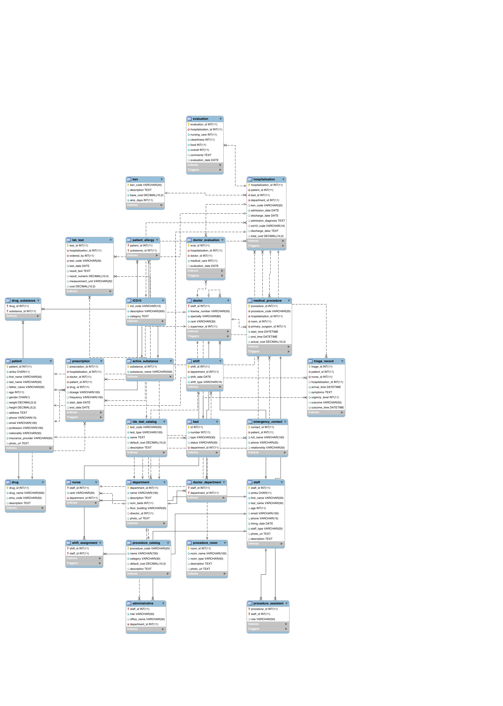

# hospital-db-26

Σχεδιασμός και υλοποίηση βάσης δεδομένων για το Γενικό Νοσοκομείο «Υγειόπολης» — εργασία για το μάθημα Βάσεις Δεδομένων, ΣΗΜΜΥ/ΕΜΠ 2025-2026.

---

## ER Diagram


---

## Relational Diagram



---

## How to setup the DB

### Prerequisites

- [Docker](https://www.docker.com/) and Docker Compose

### 1. Initial start

```bash
cd code
docker compose up --build
```

Initialisation automatically creates the schema (`install.sql`) and loads the data (`load.sql`). Duration : a couple of minutes

### 2. Normal restart

```bash
docker compose up
```

### 3. Break

```bash
docker compose down
```

### 4. Rebuild

```bash
docker compose down
docker compose up --build
```

### 5. Query UI

After start open in browser:

```
http://127.0.0.1:8765
```

Contains SQL editor, schema browser and 15 saved queries.

### 6. Connect to MySQL client

```
Host:     127.0.0.1
Port:     3307
User:     root
Password: root
Database: hospital
```

```bash
docker exec -it hospital_db mariadb -uroot -proot hospital
```

### 7. Loading verification

```bash
./verify_db.sh
```

---

## Assumptions

| # | Constraint | Assumption |
| - | --- | --- |
| 1 | Minimum shift staffing (≥3 doctors, ≥6 nurses, ≥2 administrative staff) | Enforced via a BEFORE DELETE trigger (`trg_shift_min_staffing`) on the `shift_assignment` table. Since a shift is staffed incrementally (one INSERT per member), checking the constraint on INSERT is not feasible. Instead, once a shift reaches valid staffing levels, any removal that would drop it below the minimums is automatically blocked. The operator is responsible for ensuring the shift reaches minimum staffing before it goes into effect. |
| 2 | FIFO triage | No database constraint required. The database stores `urgency_level` and `arrival_time`. The correct service order is ensured with `ORDER BY urgency_level ASC, arrival_time ASC`. |
| 3 | EMA Article 57 drugs | Drugs with incomplete or malformed substance names (fragments due to poor data quality in the source) were removed. If a drug had even one suspicious substance, the entire drug entry was removed so that every drug has a complete list of active substances. The assignment explicitly permits simplification of active substances. |
| 4 | `drug.description` | Used for route of administration (e.g. "Oral Use") as provided by the EMA Excel file, not for a textual description of the drug. |
| 5 | `drug.ema_code` | The field exists in the schema but is not populated because the EMA Excel file does not provide a unique code per product. |
