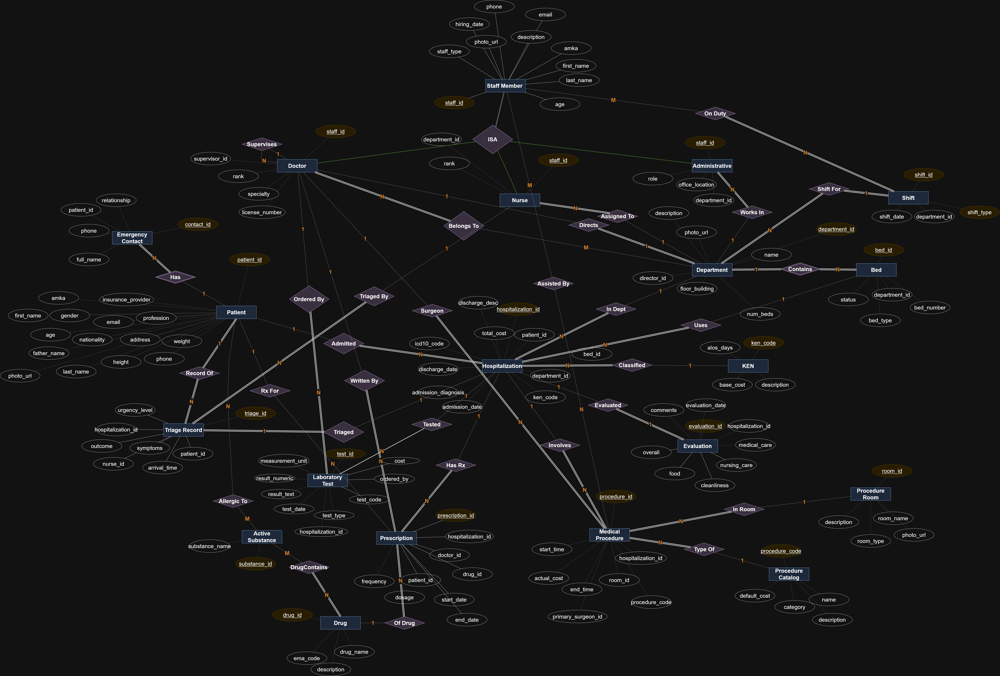
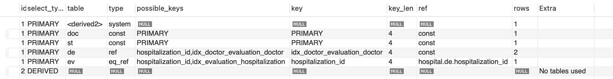
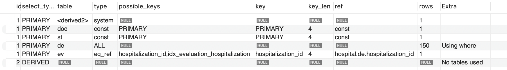
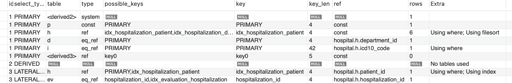
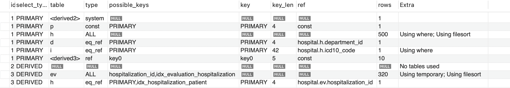

# Hospital DB — Αναφορά Εργασίας

## Πίνακας Περιεχομένων

- Πρόλογος
- Παραδοχές
- Διαδικασία δημιουργίας βάσης
  1. Διάγραμμα οντοτήτων-συσχετίσεων
  2. Δημιουργία του Schema
  3. Δημιουργία των Triggers
  4. Δημιουργία των Indices
  5. Δημιουργία σχεσιακού διαγράμματος
- 6. Ερωτήματα 4 και 6
  1. Ερώτημα 4
  2. Ερώτημα 6

---

## Πρόλογος

Σε αυτήν την αναφορά παρουσιάζουμε όλες τις τεχνικές λεπτομέρειες και τις σχεδιαστικές επιλογές που υλοποιήσαμε για τη δημιουργία μιας σχεσιακής βάσης δεδομένων ενός νοσοκομειακού συστήματος διαχείρισης. Το σύστημα αυτό, που ονομάζεται Hospital DB, αποτέλεσε την εξαμηνιαία εργασία του μαθήματος Βάσεις Δεδομένων του Ε.Μ.Π. για το ακαδημαϊκό έτος 2025-2026.

Η βάση δεδομένων σχεδιάστηκε για να υποστηρίξει τις βασικές λειτουργίες ενός γενικού νοσοκομείου, συμπεριλαμβανομένων της διαχείρισης ασθενών, του προσωπικού, των νοσηλίων, των ιατρικών διαδικασιών, των φαρμακευτικών συνταγών και της οργάνωσης βαρδιών. Η υλοποίηση έγινε σε MariaDB 10.6 μέσα σε περιβάλλον Docker, χρησιμοποιώντας καθαρή SQL, ώστε να διατηρηθεί η αυστηρότητα του σχεσιακού μοντέλου.

Η δομή της βάσης περιλαμβάνει 28 πίνακες που κατηγοριοποιούνται σε εννέα λογικές ομάδες, 19 triggers για τη διατήρηση της ακεραιότητας των δεδομένων, κατάλληλα indices για τη βελτιστοποίηση των ερωτημάτων, και 15 σύνθετα SQL ερωτήματα που αναδεικνύουν προηγμένες τεχνικές επεξεργασίας δεδομένων.

Στη συνέχεια, θα περιγράψουμε λεπτομερώς τις αρχιτεκτονικές επιλογές, τις παραδοχές σχεδίασης, τη διαδικασία δημιουργίας του schema, και θα αναλύσουμε σε βάθος δύο ιδιαίτερα απαιτητικά ερωτήματα με τα αντίστοιχα στατιστικά κόστους εκτέλεσης.

---

## Παραδοχές

### 1. Επίλυση Κυκλικής Εξάρτησης στο DDL

Στο σχεσιακό μοντέλο, υπάρχει κυκλική εξάρτηση μεταξύ των πινάκων Department και Doctor (ένας γιατρός έχει έναν προϊστάμενο που είναι γιατρός, και ένα τμήμα έχει έναν διευθυντή). Για να επιλύσουμε αυτή την κυκλική αναφορά κατά την αρχική δημιουργία της βάσης, δημιουργήσαμε πρώτα τον πίνακα Doctor χωρίς τα ξένα κλειδιά και στη συνέχεια χρησιμοποιήσαμε εντολές ALTER TABLE για να προσθέσουμε τις απαιτούμενες αναφορές.

### 2. Ελάχιστη Στελέχωση Βάρδιας

Ο περιορισμός ελάχιστης στελέχωσης βάρδιας (≥3 ιατροί, ≥6 νοσηλευτές, ≥2 διοικητικοί) επιβάλλεται μέσω BEFORE DELETE trigger (trg_shift_min_staffing) στον πίνακα shift_assignment. Καθώς η βάρδια στελεχώνεται σταδιακά (ένα INSERT ανά μέλος προσωπικού), ο έλεγχος κατά το INSERT είναι αδύνατος — η βάρδια δεν θα πληρούσε ποτέ τα ελάχιστα κατά την πρώτη καταχώρηση. Αντ' αυτού, μόλις η βάρδια αποκτήσει έγκυρη στελέχωση, κάθε απόπειρα αφαίρεσης προσωπικού που θα την υποβάθμιζε κάτω από τα ελάχιστα μπλοκάρεται αυτόματα. Ο χειριστής οφείλει να διασφαλίσει ότι η βάρδια φτάνει την ελάχιστη στελέχωση πριν τεθεί σε ισχύ.

### 3. FIFO Triage

Η σειρά εξυπηρέτησης ασθενών στο triage δεν απαιτεί constraint στη βάση. Η βάση αποθηκεύει urgency_level και arrival_time. Η σωστή σειρά εξυπηρέτησης εξασφαλίζεται με ORDER BY urgency_level ASC, arrival_time ASC.

### 4. Φάρμακα EMA Article 57

Αφαιρέθηκαν φάρμακα με ελλιπή ή λανθασμένα substance names (fragments λόγω κακής ποιότητας δεδομένων στην πηγή). Αν ένα φάρμακο είχε έστω μία περίεργη ουσία, αφαιρέθηκε ολόκληρο, ώστε κάθε φάρμακο να έχει πλήρη λίστα δραστικών ουσιών. Η εκφώνηση επιτρέπει ρητά απλοποίηση των δραστικών ουσιών.

### 5. Πεδίο drug.description

Χρησιμοποιείται για route of administration (π.χ. "Oral Use") όπως παρέχεται από το Excel της EMA, όχι για κειμενική περιγραφή του φαρμάκου.

### 6. Πεδίο drug.ema_code

Το πεδίο υπάρχει στο schema αλλά δεν φορτώνεται, διότι το Excel της EMA δεν παρέχει μοναδικό κωδικό ανά προϊόν.

---

## Διαδικασία Δημιουργίας Βάσης

### 1. Διάγραμμα Οντοτήτων-Συσχετίσεων

Το ER διάγραμμα σχεδιάστηκε με το draw.io και αποτυπώνει όλες τις οντότητες, τις συσχετίσεις και τα χαρακτηριστικά τους. Το τελικό διάγραμμα βρίσκεται στο αρχείο [diagrams/er.pdf](../diagrams/er.pdf).

#### Οντότητες

Το μοντέλο αποτελείται από τις εξής κύριες οντότητες:

| Οντότητα | Περιγραφή |
|---|---|
| **Staff** (doctor, nurse, administrative) | ISA ιεραρχία προσωπικού με γονική οντότητα και τρεις υποκλάσεις |
| **Department** | Τμήματα νοσοκομείου, με διευθυντή (FK→Doctor) |
| **Bed** | Κλίνες ανά τμήμα με κατάσταση (διαθέσιμη/κατειλημμένη/υπό συντήρηση) |
| **Shift / ShiftAssignment** | Βάρδιες ανά τμήμα και ανάθεση προσωπικού |
| **ProcedureRoom** | Χειρουργεία και αίθουσες επεμβάσεων |
| **Patient** | Ασθενείς με πλήρη δημογραφικά και ασφαλιστικό φορέα |
| **EmergencyContact** | Στοιχεία επαφής οικείων ανά ασθενή |
| **Hospitalization** | Νοσηλεία: σύνδεση ασθενή, κλίνης, τμήματος, ΚΕΝ, ICD-10 |
| **TriageRecord** | Εγγραφές τριάζ στα Επείγοντα (urgency 1-5, outcome) |
| **Evaluation / DoctorEvaluation** | Αξιολογήσεις νοσηλείας και ιατρού (Likert 1-5) |
| **LabTestCatalog / LabTest** | Κατάλογος εξετάσεων και παραγγελθείσες εξετάσεις |
| **ProcedureCatalog / MedicalProcedure** | Κατάλογος πράξεων και εκτελεσθείσες επεμβάσεις |
| **ProcedureAssistant** | Βοηθοί ανά επέμβαση (M:N) |
| **Drug / ActiveSubstance** | Φάρμακα (EMA) και δραστικές ουσίες |
| **Prescription** | Συνταγογράφηση φαρμάκων κατά νοσηλεία |
| **KEN / ICD10** | Πίνακες αναφοράς κοστολόγησης και διαγνώσεων |

#### Βασικές σχεδιαστικές επιλογές

- **ISA ιεραρχία προσωπικού:** Ο πίνακας `staff` είναι ο γονικός πίνακας. Οι υποκλάσεις `doctor`, `nurse`, `administrative` κληρονομούν με FK (`staff_id`) και CASCADE DELETE. Το πεδίο `staff_type` στον γονικό πίνακα επιτρέπει γρήγορο προσδιορισμό τύπου χωρίς JOIN — χρησιμοποιείται άμεσα στα triggers βαρδιών.
- **Κυκλική εξάρτηση Department ↔ Doctor:** Λύθηκε με ALTER TABLE — οι πίνακες δημιουργούνται χωρίς τα κυκλικά FK και προστίθενται στη συνέχεια (βλ. Παραδοχή 1).
- **Self-referencing FK στο doctor:** Το πεδίο `supervisor_id` αναφέρεται στον ίδιο πίνακα (`doctor.staff_id`) για την ιεραρχία εποπτείας. Η ακεραιότητα (υποχρεωτικός επόπτης για Ειδικευόμενο, κυκλική αλυσίδα) επιβάλλεται με triggers.
- **M:N σχέσεις:** `doctor_department` (ιατρός ↔ τμήμα), `drug_substance` (φάρμακο ↔ δραστική ουσία), `patient_allergy` (ασθενής ↔ δραστική ουσία), `shift_assignment` (προσωπικό ↔ βάρδια), `procedure_assistant` (επέμβαση ↔ βοηθός).
- **Αλλεργίες μέσω δραστικής ουσίας:** Η αλλεργία δεν συνδέεται απευθείας με φάρμακο αλλά με `active_substance`, ώστε ο έλεγχος να καλύπτει αυτόματα κάθε φάρμακο που περιέχει την ουσία.

### 2. Δημιουργία του Schema

Το schema ορίζεται στο [sql/install.sql](../sql/install.sql) και περιλαμβάνει **28 πίνακες** οργανωμένους σε εννέα λογικές ομάδες. Για κάθε πίνακα ορίστηκαν: PRIMARY KEY, UNIQUE constraints όπου απαιτείται, FOREIGN KEY με κατάλληλη πολιτική ON DELETE/ON UPDATE, και CHECK constraints για την ακεραιότητα πεδίων τιμών.

#### Ομάδα 1: Προσωπικό

| Πίνακας | Σκοπός | Βασικά πεδία |
|---|---|---|
| `staff` | Γονικός πίνακας ISA ιεραρχίας. Κοινά στοιχεία όλων των κατηγοριών. | `staff_id`, `amka` (UNIQUE), `staff_type` (CHECK: doctor/nurse/administrative) |
| `doctor` | Υποκλάση ιατρών. Self-referencing FK για ιεραρχία εποπτείας. | `staff_id` (FK→staff CASCADE), `license_number` (UNIQUE), `rank` (CHECK: 4 επίπεδα), `supervisor_id` (FK→doctor SET NULL) |
| `nurse` | Υποκλάση νοσηλευτών. Ανήκει σε τμήμα. | `staff_id` (FK→staff CASCADE), `rank` (CHECK: 3 επίπεδα), `department_id` (FK→department RESTRICT) |
| `administrative` | Υποκλάση διοικητικού προσωπικού. | `staff_id` (FK→staff CASCADE), `role`, `office_name`, `department_id` (FK→department RESTRICT) |

> **Σχεδιαστική επιλογή ISA:** Ο πίνακας `staff` ενοποιεί τα κοινά πεδία (amka, email, hiring_date, staff_type). Οι υποκλάσεις κληρονομούν με FK + CASCADE DELETE, ώστε η διαγραφή από `staff` να διαδίδεται αυτόματα. Το πεδίο `staff_type` επιτρέπει εντοπισμό τύπου χωρίς JOIN (π.χ. στα triggers βαρδιών).

#### Ομάδα 2: Τμήματα & Υποδομή

| Πίνακας | Σκοπός | Βασικά πεδία |
|---|---|---|
| `department` | Τμήματα νοσοκομείου. FK προς director_id προστίθεται με ALTER TABLE (κυκλική εξάρτηση). | `department_id`, `name` (UNIQUE), `num_beds` (CHECK ≥0), `director_id` (FK→doctor SET NULL) |
| `doctor_department` | M:N σχέση ιατρού-τμήματος. Ένας ιατρός μπορεί να ανήκει σε πολλά τμήματα. | `(staff_id, department_id)` σύνθετο PK, αμφότερα CASCADE |
| `bed` | Κλίνες ανά τμήμα. | `id`, `number`, `type`, `status` (CHECK: διαθέσιμη/κατειλημμένη/υπό συντήρηση), `department_id` (FK CASCADE) |
| `shift` | Βάρδιες ανά τμήμα και ημέρα. UNIQUE (department_id, shift_date, shift_type). | `shift_id`, `department_id`, `shift_date`, `shift_type` (CHECK: morning/afternoon/night) |
| `shift_assignment` | M:N ανάθεση προσωπικού σε βάρδιες. Σημείο επιβολής 5 triggers. | `(shift_id, staff_id)` σύνθετο PK, αμφότερα CASCADE |
| `procedure_room` | Χειρουργεία και αίθουσες επεμβάσεων. | `room_id`, `room_name`, `room_type` (CHECK: χειρουργείο/αίθουσα επέμβασης) |

#### Ομάδα 3: Ασθενείς

| Πίνακας | Σκοπός | Βασικά πεδία |
|---|---|---|
| `patient` | Στοιχεία ασθενών. | `patient_id`, `amka` (UNIQUE, CHECK LENGTH=11), `gender` (CHECK: M/F), `age` (CHECK 0-120), `insurance_provider` |
| `emergency_contact` | Στοιχεία οικείων για επείγοντα. | `contact_id`, `patient_id` (FK→patient CASCADE), `full_name`, `phone`, `relationship` |

#### Ομάδα 4: Νοσηλεία

| Πίνακας | Σκοπός | Βασικά πεδία |
|---|---|---|
| `hospitalization` | Κεντρικός πίνακας νοσηλειών. Συνδέει ασθενή, κλίνη, τμήμα, ΚΕΝ, ICD-10. | `hospitalization_id`, `patient_id` (RESTRICT), `bed_id` (RESTRICT), `department_id` (RESTRICT), `ken_code` (SET NULL), `icd10_code` (CASCADE), `admission_date`, `discharge_date`, `total_cost` |
| `triage_record` | Εγγραφές τριάζ από τα Επείγοντα. | `triage_id`, `patient_id`, `nurse_id`, `urgency_level` (CHECK 1-5), `arrival_time`, `outcome` (CHECK: αποχώρηση/νοσηλεία) |
| `evaluation` | Αξιολόγηση νοσηλείας (1 ανά νοσηλεία). Κλίμακα Likert 1-5. | `evaluation_id`, `hospitalization_id` (UNIQUE), `nursing_care`, `cleanliness`, `food`, `overall` |
| `doctor_evaluation` | Αξιολόγηση ιατρού από ασθενή. UNIQUE (hospitalization_id, doctor_id). | `eval_id`, `hospitalization_id`, `doctor_id`, `medical_care` (CHECK 1-5) |

#### Ομάδα 5: Εργαστηριακές Εξετάσεις

| Πίνακας | Σκοπός | Βασικά πεδία |
|---|---|---|
| `lab_test_catalog` | Κατάλογος αναφοράς τύπων εξετάσεων. | `test_code` (PK), `test_type`, `name`, `default_cost` |
| `lab_test` | Παραγγελθείσες εξετάσεις ανά νοσηλεία. | `test_id`, `hospitalization_id` (CASCADE), `ordered_by` (FK→doctor RESTRICT), `test_code` (FK RESTRICT), `result_text`, `result_numeric` |

#### Ομάδα 6: Ιατρικές Πράξεις

| Πίνακας | Σκοπός | Βασικά πεδία |
|---|---|---|
| `procedure_catalog` | Κατάλογος ιατρικών πράξεων. | `procedure_code` (PK), `name`, `category` (CHECK: χειρουργική/διαγνωστική/θεραπευτική), `default_cost` |
| `medical_procedure` | Εκτελεσθείσες επεμβάσεις. | `procedure_id`, `room_id` (RESTRICT), `primary_surgeon_id` (RESTRICT), `start_time`, `end_time`, `actual_cost` |
| `procedure_assistant` | M:N βοηθοί σε επεμβάσεις. | `(procedure_id, staff_id)` σύνθετο PK, `role` |

#### Ομάδα 7: Φάρμακα & Συνταγογράφηση

| Πίνακας | Σκοπός | Βασικά πεδία |
|---|---|---|
| `drug` | Φάρμακα από κατάλογο EMA Article 57. | `drug_id`, `drug_name`, `ema_code`, `description` (route of administration) |
| `active_substance` | Δραστικές ουσίες. UNIQUE (substance_name). | `substance_id`, `substance_name` |
| `drug_substance` | M:N φαρμάκου-δραστικής ουσίας. | `(drug_id, substance_id)` σύνθετο PK, αμφότερα CASCADE |
| `patient_allergy` | M:N αλλεργιών ασθενή σε δραστικές ουσίες. | `(patient_id, substance_id)` σύνθετο PK, αμφότερα CASCADE |
| `prescription` | Συνταγογράφηση. UNIQUE (doctor_id, patient_id, drug_id, start_date). | `prescription_id`, `hospitalization_id`, `doctor_id`, `patient_id`, `drug_id`, `dosage`, `frequency`, `start_date`, `end_date` |

#### Ομάδα 8: Πίνακες Αναφοράς

| Πίνακας | Σκοπός | Βασικά πεδία |
|---|---|---|
| `ken` | Κλειστά Ενοποιημένα Νοσήλια — πίνακας κοστολόγησης νοσηλειών. | `ken_code` (PK), `description`, `base_cost` (CHECK ≥0), `alos_days` (CHECK >0) |
| `ICD10` | Κωδικοί διαγνώσεων ICD-10. | `icd_code` (PK), `description`, `category` |

---

### 3. Δημιουργία των Triggers

Το σύστημα διαθέτει **19 triggers** που επιβάλλουν αυτόματα τους κανόνες ακεραιότητας. Παρακάτω αναλύεται κάθε trigger ξεχωριστά.

#### Ομάδα Α: Εποπτεία Ιατρών (4 triggers)

**`trg_doctor_supervisor_insert` / `trg_doctor_supervisor_update`** — BEFORE INSERT/UPDATE ON `doctor`

Επιβάλλουν δύο κανόνες ιεραρχίας: (α) κάθε Ειδικευόμενος **πρέπει** να έχει επόπτη (`supervisor_id IS NOT NULL`), (β) κάθε Διευθυντής **δεν επιτρέπεται** να έχει επόπτη (`supervisor_id IS NULL`). Εκτελούνται και στο INSERT και στο UPDATE ώστε να μην παρακαμφθεί ο κανόνας με μεταγενέστερη ενημέρωση.

**`trg_doctor_no_cycle_insert` / `trg_doctor_no_cycle_update`** — BEFORE INSERT/UPDATE ON `doctor`

Αποτρέπουν κυκλικές αλυσίδες στο self-referencing supervisor tree (π.χ. Α→Β→Γ→Α). Ακολουθούν αναδρομικά την αλυσίδα `supervisor_id` έως βάθος 50 με `WHILE` loop· αν συναντηθεί το `staff_id` του νέου γιατρού, το INSERT/UPDATE αποτυγχάνει.

#### Ομάδα Β: Συνταγογράφηση (1 trigger)

**`trg_prescription_allergy_check`** — BEFORE INSERT ON `prescription`

Πριν καταχωρηθεί συνταγή, ελέγχει αν οποιαδήποτε δραστική ουσία του φαρμάκου (`drug_substance`) εμφανίζεται στις αλλεργίες του ασθενή (`patient_allergy`). Αν βρεθεί έστω μία κοινή ουσία, το INSERT αποτυγχάνει με μήνυμα αλλεργίας.

#### Ομάδα Γ: Αξιολογήσεις (2 triggers)

**`trg_evaluation_discharged`** — BEFORE INSERT ON `evaluation`

Επιτρέπει αξιολόγηση νοσηλείας μόνο αν η νοσηλεία έχει `discharge_date IS NOT NULL`, δηλαδή έχει ολοκληρωθεί. Εμποδίζει αξιολόγηση ενεργούς νοσηλείας.

**`trg_doctor_evaluation_check`** — BEFORE INSERT ON `doctor_evaluation`

Συνδυασμένος έλεγχος δύο προϋποθέσεων: (α) η νοσηλεία πρέπει να έχει `discharge_date`, (β) ο προς αξιολόγηση ιατρός πρέπει να έχει εκδώσει τουλάχιστον μία συνταγή για αυτή τη νοσηλεία. Αποτρέπει τυχαίες αξιολογήσεις ιατρών που δεν παρείχαν φροντίδα.

#### Ομάδα Δ: Βάρδιες (5 triggers)

**`trg_shift_monthly_limit`** — BEFORE INSERT ON `shift_assignment`

Μηνιαίο όριο βαρδιών ανά κατηγορία: ιατροί ≤15, νοσηλευτές ≤20, διοικητικό ≤25. Μετράει τις ήδη υπάρχουσες βάρδιες του μέλους στον ίδιο μήνα (YEAR + MONTH) και αποτρέπει υπέρβαση.

**`trg_shift_rest_period`** — BEFORE INSERT ON `shift_assignment`

Ελάχιστο διάστημα ανάπαυσης 8 ωρών μεταξύ διαδοχικών βαρδιών. Μετατρέπει κάθε `shift_type` σε ακριβές χρονικό διάστημα (morning: 07:00–15:00, afternoon: 15:00–23:00, night: 23:00–07:00+1) και ελέγχει overlap με 8h buffer ανάμεσα στο τέλος της υπάρχουσας και την αρχή της νέας βάρδιας (και αντίστροφα).

**`trg_shift_consecutive_nights`** — BEFORE INSERT ON `shift_assignment`

Απαγορεύει 4η συνεχόμενη νυχτερινή βάρδια. Αν η νέα βάρδια είναι `night`, ελέγχει αν υπάρχουν night βάρδιες τις 3 αμέσως προηγούμενες ημερολογιακές ημέρες (`DATE_SUB` -1, -2, -3). Αν βρεθούν και οι 3, αποτρέπει το INSERT.

**`trg_shift_trainee_requires_senior`** — BEFORE INSERT ON `shift_assignment`

Ειδικευόμενος δεν μπορεί να ανατεθεί σε βάρδια εκτός αν στην ίδια βάρδια συμμετέχει ήδη τουλάχιστον ένας Επιμελητής Α ή Διευθυντής. Ο έλεγχος γίνεται μόνο για staff_type='doctor' με rank='Ειδικευόμενος'.

**`trg_shift_min_staffing`** — BEFORE DELETE ON `shift_assignment`

Προστατεύει την ελάχιστη στελέχωση βάρδιας (≥3 ιατροί, ≥6 νοσηλευτές, ≥2 διοικητικοί). Εκτελείται BEFORE DELETE: μετράει τα εναπομείναντα μέλη της ίδιας κατηγορίας μετά την αφαίρεση, και αποτρέπει το DELETE αν το αποτέλεσμα πέφτει κάτω από το ελάχιστο. Η επιλογή BEFORE DELETE (αντί BEFORE INSERT) εξηγείται στην ενότητα Παραδοχών.

#### Ομάδα Ε: Επεμβάσεις (3 triggers)

**`trg_procedure_room_overlap`** — BEFORE INSERT ON `medical_procedure`

Δεν επιτρέπει δύο ταυτόχρονες επεμβάσεις στον ίδιο χώρο. Ελέγχει χρονικό overlap με τη συνθήκη `NEW.start_time < existing.end_time AND existing.start_time < NEW.end_time`, χρησιμοποιώντας `COALESCE(end_time, '9999-12-31')` για in-progress επεμβάσεις χωρίς end_time.

**`trg_procedure_doctor_overlap`** — BEFORE INSERT ON `medical_procedure`

Ο κύριος χειρουργός δεν μπορεί να συμμετέχει ταυτόχρονα σε άλλη επέμβαση, είτε ως κύριος είτε ως βοηθός. Εκτελεί δύο διαφορετικούς ελέγχους overlap: έναντι `medical_procedure.primary_surgeon_id` και έναντι `procedure_assistant.staff_id`.

**`trg_procedure_assistant_overlap`** — BEFORE INSERT ON `procedure_assistant`

Ο βοηθός που προστίθεται σε επέμβαση δεν πρέπει να συμμετέχει ήδη σε άλλη ταυτόχρονη επέμβαση — ούτε ως κύριος χειρουργός ούτε ως βοηθός. Ανακτά πρώτα τα start/end_time της τρέχουσας επέμβασης και ελέγχει αντίστοιχα.

#### Ομάδα ΣΤ: Κλίνες & Κόστος (4 triggers)

**`trg_hospitalization_bed_check`** — BEFORE INSERT ON `hospitalization`

Πριν καταχωρηθεί νοσηλεία, επαληθεύει ότι η επιλεγμένη κλίνη έχει `status = 'διαθέσιμη'`. Αποτρέπει διπλοκράτηση κλίνης.

**`trg_hospitalization_bed_occupy`** — AFTER INSERT ON `hospitalization`

Μετά την εισαγωγή νοσηλείας, ενημερώνει αυτόματα `bed.status = 'κατειλημμένη'`.

**`trg_hospitalization_bed_free`** — AFTER UPDATE ON `hospitalization`

Ανιχνεύει τη μετάβαση `discharge_date: NULL → NOT NULL` (δηλαδή έξοδο ασθενή) και ενημερώνει `bed.status = 'διαθέσιμη'`.

**`trg_hospitalization_cost`** — BEFORE UPDATE ON `hospitalization`

Υπολογίζει αυτόματα το `total_cost` κατά την έξοδο ασθενή, βάσει ΚΕΝ: αν η πραγματική νοσηλεία (actual_days) υπερβαίνει το τυπικό ALOS, επιβάλλεται πρόσθετη ημερήσια χρέωση `base_cost / alos_days` ανά επιπλέον ημέρα. Εκτελείται BEFORE UPDATE ώστε να θέτει `NEW.total_cost` απευθείας (απαγορεύεται UPDATE στον ίδιο πίνακα σε AFTER trigger).

---

### 4. Δημιουργία των Indices

Ορίστηκαν **25 indexes** βελτιστοποιημένοι για τα 15 ερωτήματα. Τα κριτήρια επιλογής: στήλες που εμφανίζονται σε JOIN conditions, WHERE clauses με φίλτρα υψηλής επιλεκτικότητας και GROUP BY expressions.

#### Νοσηλείες — πίνακας `hospitalization`

| Index | Στήλη(ες) | Ερωτήματα που εξυπηρετεί |
|---|---|---|
| `idx_hospitalization_patient` | `patient_id` | Q03, Q06, Q09: JOIN με `patient` για αναζήτηση ιστορικού ασθενή |
| `idx_hospitalization_department` | `department_id` | Q01, Q03: JOIN με `department` για στατιστικά ανά τμήμα |
| `idx_hospitalization_admission` | `admission_date` | Q01, Q09, Q14: GROUP BY YEAR(admission_date) για ετήσια στατιστικά |
| `idx_hospitalization_ken` | `ken_code` | Q01: LEFT JOIN με `ken` για κοστολόγηση |
| `idx_hospitalization_icd` | `icd10_code` | Q06, Q14: LEFT JOIN με `ICD10` για διαγνώσεις |

#### Ιατροί — πίνακας `doctor`

| Index | Στήλη(ες) | Ερωτήματα που εξυπηρετεί |
|---|---|---|
| `idx_doctor_specialty` | `specialty` | Q02, Q05: WHERE/GROUP BY specialty |
| `idx_doctor_rank` | `rank` | Q13: φιλτράρισμα ανά βαθμίδα ιεραρχίας |
| `idx_doctor_supervisor` | `supervisor_id` | Q13: recursive CTE JOIN ON supervisor_id |

#### Βάρδιες — πίνακες `shift`, `shift_assignment`

| Index | Στήλη(ες) | Ερωτήματα που εξυπηρετεί |
|---|---|---|
| `idx_shift_date` | `shift_date` | Q08, Q12: WHERE/BETWEEN shift_date |
| `idx_shift_dept_date` | `(department_id, shift_date)` | Q08, Q12: σύνθετο φίλτρο τμήματος+ημερομηνίας — composite index αποφεύγει δύο χωριστές σαρώσεις |
| `idx_shift_assignment_staff` | `staff_id` | Q02, Q08, Q12: JOIN staff σε βάρδιες |

#### Εξετάσεις & Επεμβάσεις

| Index | Στήλη(ες) | Ερωτήματα που εξυπηρετεί |
|---|---|---|
| `idx_lab_test_hospitalization` | `hospitalization_id` | γενικό JOIN lab_test → hospitalization |
| `idx_procedure_surgeon` | `primary_surgeon_id` | Q02, Q05, Q11: JOIN χειρουργός |
| `idx_procedure_start_time` | `start_time` | Q02, Q11: YEAR(start_time) φίλτρο ανά έτος |

#### Προσωπικό — πίνακας `staff`

| Index | Στήλη(ες) | Ερωτήματα που εξυπηρετεί |
|---|---|---|
| `idx_staff_age` | `age` | Q05: WHERE age < 35 (range query — B-tree index αποδοτικός) |

#### Φάρμακα & Ουσίες

| Index | Στήλη(ες) | Ερωτήματα που εξυπηρετεί |
|---|---|---|
| `idx_drug_name` | `drug_name` | load.sql: JOIN κατά φόρτωση |
| `idx_drug_substance_drug` | `drug_id` | Q10: JOIN `drug_substance` ON drug_id (148k rows) |
| `idx_drug_substance_substance` | `substance_id` | Q07, Q10: JOIN `drug_substance` ON substance_id |

#### Συνταγογράφηση — πίνακας `prescription`

| Index | Στήλη(ες) | Ερωτήματα που εξυπηρετεί |
|---|---|---|
| `idx_prescription_patient` | `patient_id` | Q10: JOIN συνταγές ίδιου ασθενή |
| `idx_prescription_doctor` | `doctor_id` | trigger `trg_doctor_evaluation_check`: έλεγχος συνταγογράφησης |
| `idx_prescription_hospitalization` | `hospitalization_id` | Q10: self-join ON hospitalization_id |

#### Αλλεργίες & Αξιολογήσεις

| Index | Στήλη(ες) | Ερωτήματα που εξυπηρετεί |
|---|---|---|
| `idx_patient_allergy_substance` | `substance_id` | Q07: JOIN ουσία-αλλεργία |
| `idx_triage_urgency` | `urgency_level` | Q15: GROUP BY urgency_level |
| `idx_evaluation_hospitalization` | `hospitalization_id` | Q04, Q06: JOIN αξιολόγηση νοσηλείας |
| `idx_doctor_evaluation_doctor` | `doctor_id` | Q04: JOIN αξιολόγηση γιατρού — αυτός ο index αναλύεται εκτενώς στο Q4 |

Η αποτελεσματικότητα των indexes αναλύεται στα ερωτήματα Q4 και Q6 με EXPLAIN/FORCE INDEX.

### 5. Δημιουργία Σχεσιακού Διαγράμματος

Το σχεσιακό διάγραμμα βρίσκεται στο αρχείο [diagrams/relational.pdf](../diagrams/relational.pdf) και απεικονίζει όλους τους 28 πίνακες με τα πεδία, τα κλειδιά και τις σχέσεις αναφοράς μεταξύ τους.

Οι κύριες συνδέσεις που απεικονίζονται στο διάγραμμα:

| Σχέση | Πίνακες | Τύπος | Πολιτική |
|---|---|---|---|
| staff → doctor/nurse/administrative | ISA κληρονομιά | 1:1 | CASCADE DELETE |
| department → director | Διευθυντής τμήματος | N:1 | SET NULL |
| doctor ↔ department | Ιατρός σε τμήματα | M:N μέσω `doctor_department` | CASCADE |
| doctor → supervisor | Εποπτεία | N:1 self-join | SET NULL |
| nurse/administrative → department | Ανήκει σε τμήμα | N:1 | RESTRICT |
| bed → department | Κλίνη σε τμήμα | N:1 | CASCADE |
| shift → department | Βάρδια τμήματος | N:1 | CASCADE |
| staff ↔ shift | Ανάθεση βάρδιας | M:N μέσω `shift_assignment` | CASCADE |
| patient → hospitalization | Νοσηλεία ασθενή | 1:N | RESTRICT |
| hospitalization → bed | Κλίνη νοσηλείας | N:1 | RESTRICT |
| hospitalization → ken | ΚΕΝ κοστολόγησης | N:1 | SET NULL |
| hospitalization → ICD10 | Διάγνωση ICD-10 | N:1 | CASCADE |
| hospitalization → evaluation | Αξιολόγηση νοσηλείας | 1:1 | CASCADE |
| hospitalization ↔ doctor_evaluation | Αξιολόγηση ιατρών | 1:N | CASCADE |
| hospitalization → prescription | Συνταγές νοσηλείας | 1:N | CASCADE |
| prescription → drug | Φάρμακο συνταγής | N:1 | RESTRICT |
| drug ↔ active_substance | Δραστικές ουσίες | M:N μέσω `drug_substance` | CASCADE |
| patient ↔ active_substance | Αλλεργίες | M:N μέσω `patient_allergy` | CASCADE |
| hospitalization → medical_procedure | Επεμβάσεις νοσηλείας | 1:N | CASCADE |
| medical_procedure → procedure_room | Χώρος επέμβασης | N:1 | RESTRICT |
| medical_procedure → doctor (surgeon) | Κύριος χειρουργός | N:1 | RESTRICT |
| medical_procedure ↔ staff | Βοηθοί επέμβασης | M:N μέσω `procedure_assistant` | CASCADE |
| hospitalization → lab_test | Εξετάσεις νοσηλείας | 1:N | CASCADE |

---

## 6. Ανάλυση Ερωτημάτων Q4 & Q6 — EXPLAIN / FORCE INDEX

### Q4 — Μέσος Όρος Αξιολόγησης Ιατρού

#### Εκτέλεση με index (idx_doctor_evaluation_doctor)

#### Εκτέλεση με FORCE INDEX (PRIMARY)

#### Σύγκριση

| | Κανονική εκτέλεση | FORCE INDEX (PRIMARY) |
|---|---|---|
| key (doctor_evaluation) | idx_doctor_evaluation_doctor | PRIMARY |
| rows | 2 | 150 |
| Χρόνος εκτέλεσης | 0.020 sec | 0.021 sec |

Το ερώτημα Q4 αναζητά τις αξιολογήσεις συγκεκριμένου ιατρού (doctor_id = 2) στον πίνακα doctor_evaluation. Ο optimizer επιλέγει αυτόματα τον index idx_doctor_evaluation_doctor, εκτιμώντας 2 γραμμές αντί για πλήρη σάρωση. Με FORCE INDEX (PRIMARY), αναγκάζεται να χρησιμοποιήσει τον primary key (eval_id), ο οποίος δεν βοηθά στην αναζήτηση βάσει doctor_id, με αποτέλεσμα σάρωση 150 γραμμών. Ο χρόνος εκτέλεσης δεν διαφέρει αισθητά (0.020 vs 0.021 sec) γιατί ο μικρός πίνακας χωράει στη μνήμη χωρίς disk I/O. Σε μεγαλύτερο dataset, η διαφορά rows θα αντικατοπτριζόταν άμεσα στον χρόνο απόκρισης.

---

### Q6 — Ιστορικό Νοσηλειών Ασθενή

#### Εκτέλεση με index (idx_hospitalization_patient)

#### Εκτέλεση με FORCE INDEX (idx_hospitalization_icd)

#### Σύγκριση

| | Κανονική εκτέλεση | FORCE INDEX (idx_hospitalization_icd) |
|---|---|---|
| key (hospitalization) | idx_hospitalization_patient | idx_hospitalization_icd |
| rows | 6 | 500 |
| Χρόνος εκτέλεσης | 0.023 sec | 0.020 sec |

Το ερώτημα Q6 εντοπίζει τις νοσηλείες συγκεκριμένου ασθενή (patient_id = 8) στον πίνακα hospitalization. Ο optimizer επιλέγει τον idx_hospitalization_patient, εκτιμώντας 6 γραμμές. Με FORCE INDEX στον idx_hospitalization_icd, ο οποίος αφορά το πεδίο icd10_code και όχι το patient_id, ο optimizer αδυνατεί να αξιοποιήσει τον index για το JOIN condition και εκτιμά σάρωση 500 γραμμών. Ο χρόνος παραμένει παρόμοιος (0.023 vs 0.020 sec) λόγω του μικρού μεγέθους του πίνακα που χωράει στο buffer pool. Η εκφώνηση αναφέρει ρητά ότι οι διαφορές στα query plans γίνονται ορατές με ικανό αριθμό δεδομένων — σε παραγωγικό σύστημα η διαφορά σε rows (6 vs 500) θα είχε άμεσο αντίκτυπο στον χρόνο εκτέλεσης.